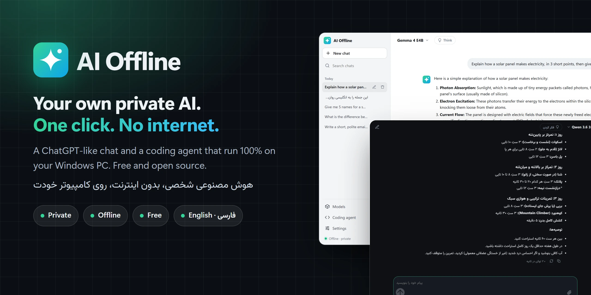
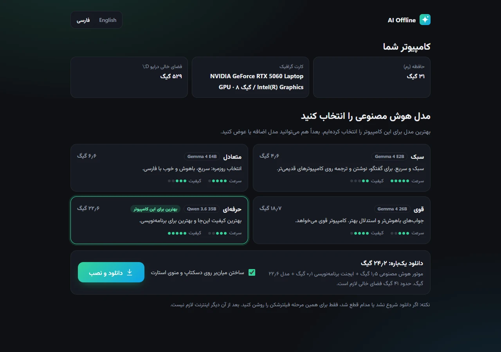
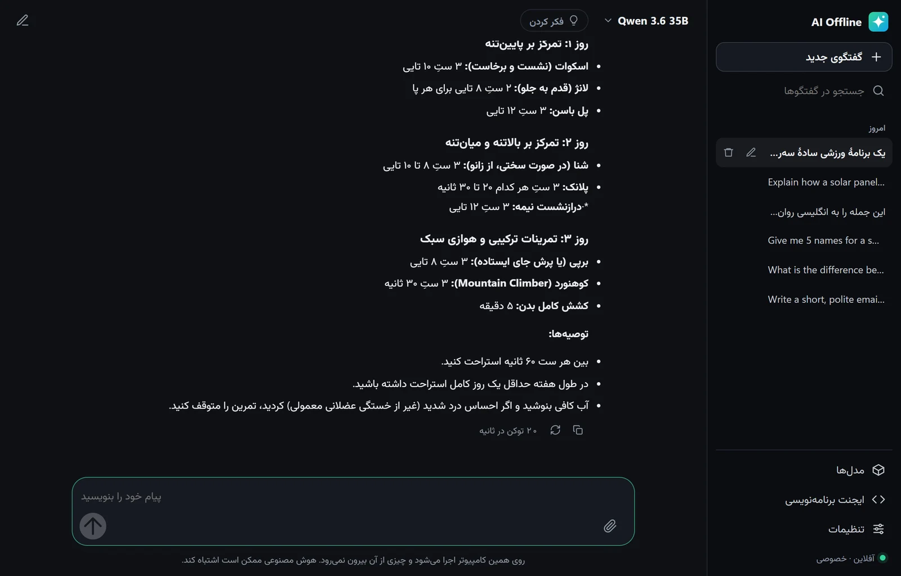

  

<h1 align="center">AI Offline | هوش مصنوعی آفلاین</h1>

  <b>هوش مصنوعی شبیه ChatGPT و یک ایجنت برنامه‌نویسی که کاملاً روی کامپیوتر خودتان اجرا می‌شوند.</b> 
  نصب با یک دابل‌کلیک، رایگان، خصوصی و بدون نیاز به اینترنت.

  

  <a href="README.md">English</a> · <b>فارسی</b>

## چرا AI Offline؟

اجرای هوش مصنوعی روی کامپیوتر شخصی معمولاً یعنی کار با ترمینال، پایتون و انتخاب دستی فایل مدل. AI Offline همهٔ این‌ها را به یک دابل‌کلیک تبدیل کرده است.

- **🔒 خصوصی:** سؤال‌ها، فایل‌ها و گفتگوهای شما هیچ‌وقت از کامپیوترتان بیرون نمی‌روند. بدون ثبت‌نام و بدون ردیابی.
- **📴 بدون اینترنت:** بعد از یک بار دانلود، دیگر به اینترنت نیاز ندارد. در قطعی اینترنت، سفر یا جاهای بدون پوشش هم کار می‌کند.
- **🧠 مدل مناسب را خودش انتخاب می‌کند:** رم، کارت گرافیک و فضای خالی کامپیوتر را بررسی می‌کند و بهترین مدلی را که اجرا می‌شود پیشنهاد می‌دهد.
- **💬 شبیه ChatGPT:** تاریخچهٔ گفتگو، متن مرتب، کد با دکمهٔ کپی، فرستادن عکس و فایل متنی، حالت «فکر کردن» و تم روشن و تیره.
- **👩‍💻 ایجنت برنامه‌نویسی:** [OpenCode](https://github.com/anomalyco/opencode)، ایجنتی شبیه Claude Code که با مدلِ روی کامپیوتر خودتان کار می‌کند؛ پروژه را می‌خواند، کد می‌نویسد و دستور اجرا می‌کند.
- **🇮🇷 فارسی کامل:** رابط راست‌به‌چپ، اعداد فارسی، و مدل‌هایی که به زبان خودتان جواب می‌دهند.
- **💾 قابل حمل:** همه‌چیز داخل یک پوشه است. آن را روی فلش بریزید و روی یک کامپیوتر دیگر بدون اینترنت اجرا کنید.
- **🆓 رایگان و متن‌باز** (مجوز MIT).

## نصب در سه قدم

۱. **[فایل AI-Offline.zip را دانلود کنید](https://github.com/Mr-sdn/ai-offline/releases/latest/download/AI-Offline.zip)**

۲. روی فایل ZIP راست‌کلیک کنید و **Extract All** را بزنید. پوشه را روی درایوی بگذارید که فضای خالی کافی دارد (مثلاً `D:\AI-Offline`).

۳. روی **`AI Offline.bat`** دو بار کلیک کنید و مراحل روی صفحه را دنبال کنید.

> **پیام «Windows protected your PC» آمد؟** روی **More info** و بعد **Run anyway** بزنید. این پیام برای برنامه‌هایی می‌آید که امضای دیجیتال پولی ندارند؛ تمام کد AI Offline در همین صفحه قابل دیدن است.

> **نکته برای کاربران ایران:** اگر دانلود شروع نشد یا مدام قطع شد، فقط برای مرحلهٔ نصب فیلترشکن را روشن کنید و «دوباره» را بزنید. دانلود از همان‌جایی که قطع شده ادامه پیدا می‌کند. بعد از نصب، دیگر اینترنت لازم نیست.

بار اول، موتور هوش مصنوعی و مدلی که انتخاب کرده‌اید دانلود می‌شود (یک بار، بین ۵ تا ۲۵ گیگابایت). از آن به بعد **AI Offline** را از دسکتاپ یا منوی استارت باز کنید.

  

## کدام مدل برای من نصب می‌شود؟

AI Offline کامپیوترتان را بررسی می‌کند و یکی از این‌ها را پیشنهاد می‌دهد. بعداً هم از بخش **مدل‌ها** می‌توانید مدل اضافه یا حذف کنید.

| رم کامپیوتر | مدل | حجم دانلود | مناسب برای |
|---|---|---|---|
| ۸ گیگ | **Gemma 4 E2B** | ۴٫۶ گیگ | گفتگو، نوشتن و ترجمه روی کامپیوترهای قدیمی‌تر |
| ۱۶ گیگ | **Gemma 4 E4B** | ۶٫۶ گیگ | استفادهٔ روزمره: سریع، باهوش و خوب با فارسی |
| ۲۴ گیگ | **Gemma 4 26B** | ۱۸٫۷ گیگ | سؤال‌های سخت‌تر و استدلال بهتر |
| ۳۲ گیگ و بیشتر | **Qwen 3.6 35B** | ۲۲٫۶ گیگ | بهترین کیفیت و بهترین برای برنامه‌نویسی |

کارت گرافیک (انویدیا یا AMD) جواب‌ها را خیلی سریع‌تر می‌کند، ولی ضروری نیست.

## تصاویر

  

## سؤال‌های رایج

<b>واقعاً رایگان است؟</b>

بله. AI Offline رایگان و متن‌باز است. مدل‌ها هم مدل‌های رایگانی هستند که گوگل (Gemma)، علی‌بابا (Qwen) و دیگران منتشر کرده‌اند و روی سخت‌افزار خودتان اجرا می‌شوند؛ پس هزینه‌ای در کار نیست.

<b>به خوبی ChatGPT است؟</b>

مدل‌های محلی از بزرگ‌ترین مدل‌های آنلاین کوچک‌ترند و در سؤال‌های خیلی سخت بیشتر اشتباه می‌کنند. برای نوشتن، ترجمه، توضیح، خلاصه‌نویسی و برنامه‌نویسی روزمره خوب کار می‌کنند، و روی کامپیوتر ۳۲ گیگی، Qwen 3.6 واقعاً قوی است. در عوض حریم خصوصی، بی‌محدودیتی و استقلال از اینترنت دارید.

<b>چرا اولین جواب کند است؟</b>

مدل اول باید از دیسک داخل حافظه بارگذاری شود؛ بسته به مدل و سرعت دیسک، از ۱۰ ثانیه تا یکی‌دو دقیقه. جواب‌های بعدی خیلی سریع‌ترند.

<b>چطور بدون اینترنت به کس دیگری بدهم؟</b>

کل پوشهٔ AI Offline (موتور، مدل‌ها و همه‌چیز) را روی فلش کپی کنید. روی کامپیوتر دیگر، پوشه را روی یک درایو کپی کنید و روی `AI Offline.bat` دو بار کلیک کنید. بدون هیچ دانلودی بالا می‌آید.

<b>فایل‌هایم کجاست؟ چطور حذفش کنم؟</b>

همه‌چیز داخل پوشهٔ AI Offline است: `runtime` (موتور)، `models` (مدل‌ها) و `data` (گفتگوها، تنظیمات و گزارش‌ها). برای حذف، فایل **More › Uninstall.bat** را اجرا کنید (میان‌برها پاک می‌شوند) و بعد پوشه را پاک کنید.

<b>جواب‌ها خیلی کند است.</b>

از بخش **مدل‌ها** یک مدل کوچک‌تر انتخاب کنید، برنامه‌های سنگین را ببندید و «فکر کردن» را خاموش کنید.

## حریم خصوصی

- موتور هوش مصنوعی فقط روی خود کامپیوتر (`127.0.0.1`) در دسترس است و قابلیت‌های ابری‌اش خاموش است.
- AI Offline فقط برای دانلود موتور و مدل‌ها از اینترنت استفاده می‌کند، آن هم فقط وقتی خودتان بخواهید.
- هیچ آمار، ردیاب یا حساب کاربری‌ای در کار نیست.

## پیشنهاد، گزارش مشکل و همکاری

مشکلی دیدید یا پیشنهادی دارید؟ در بخش [Issues](https://github.com/Mr-sdn/ai-offline/issues/new/choose) بنویسید (فارسی هم اشکال ندارد) و فایل‌های پوشهٔ `data\logs` را پیوست کنید.

اگر AI Offline به کارتان آمد، با دادن ⭐ کمک کنید دیگران هم پیدایش کنند.

ساخته‌شده توسط [امیرحسین سدنی (SDN)](https://mr-sdn.github.io). برای انجام پروژه‌های برنامه‌نویسی و هوش مصنوعی در [تلگرام](https://t.me/amirhosseinsdn) پیام بدهید.

