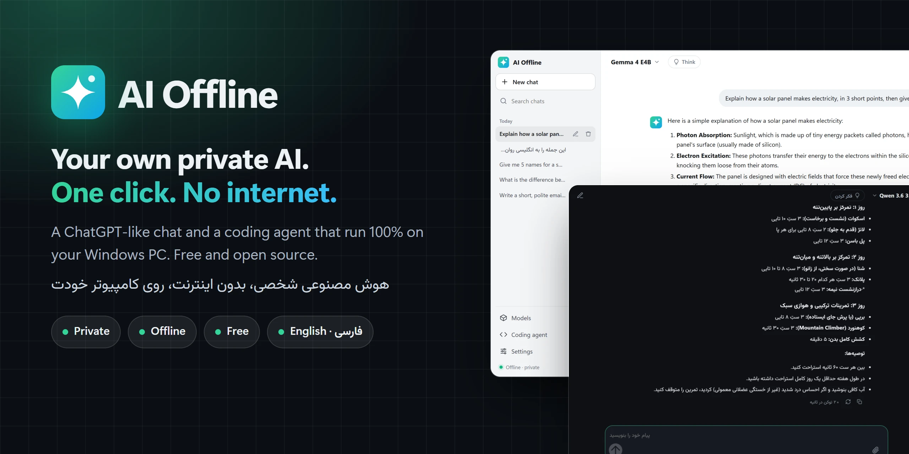
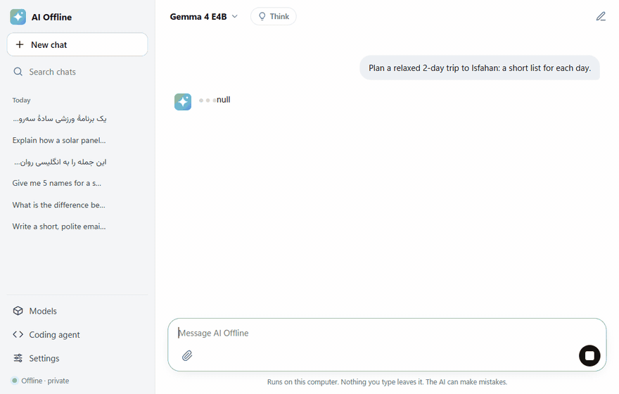
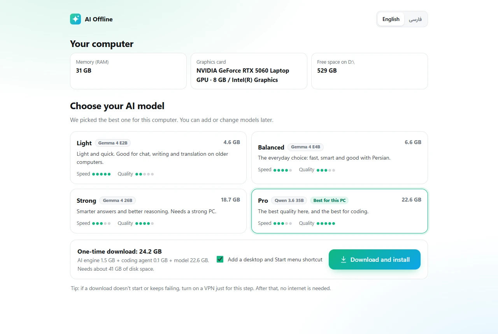
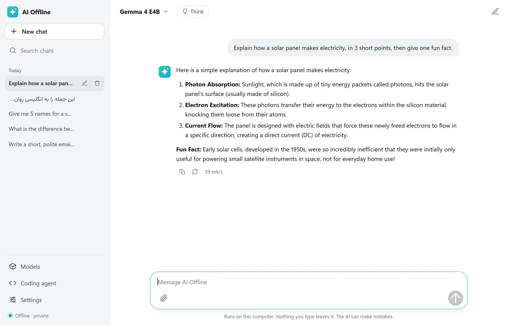
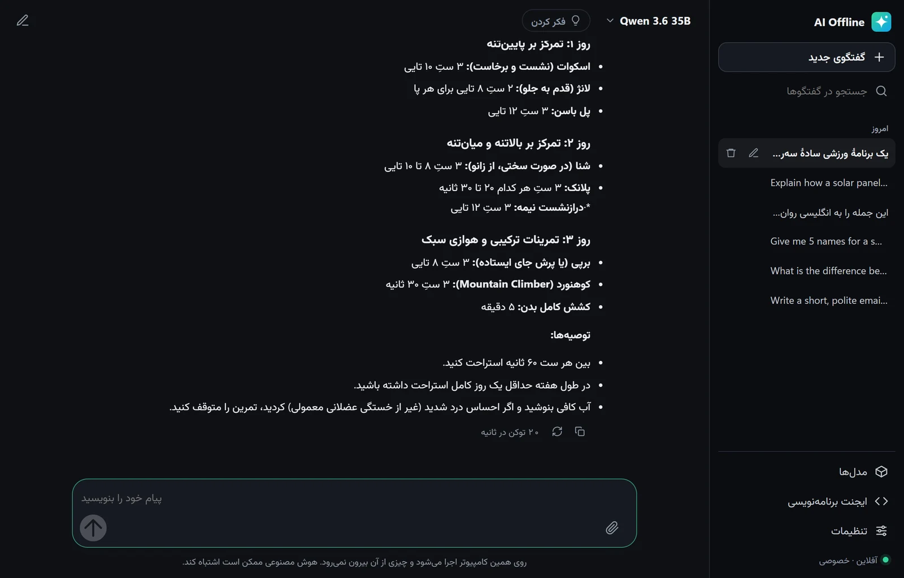
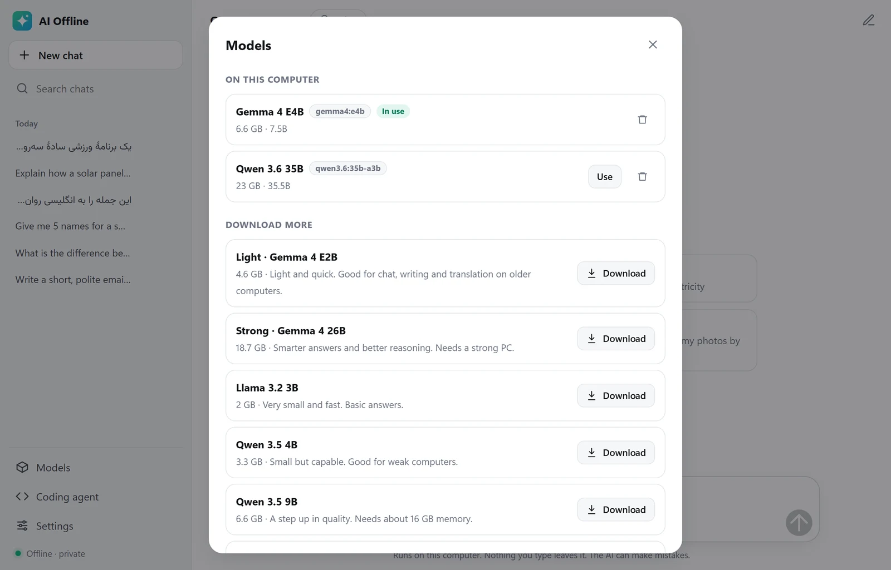
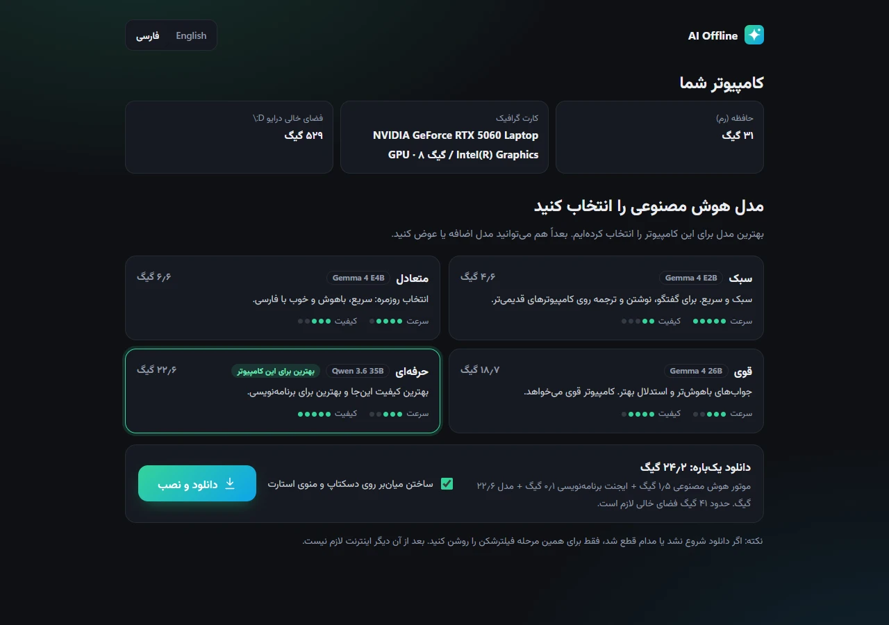

<p align="center">
  
</p>

<h1 align="center">AI Offline</h1>

<p align="center">
  <b>A ChatGPT-like AI and a coding agent that run 100% on your Windows PC.</b><br>
  One double-click to install. Private, free, and it keeps working without internet.
</p>

<p align="center">
  <a href="https://github.com/Mr-sdn/ai-offline/releases/latest/download/AI-Offline.zip"></a>
</p>

<p align="center">
  <a href="https://github.com/Mr-sdn/ai-offline/releases/latest"></a>
  <a href="https://github.com/Mr-sdn/ai-offline/releases"></a>
  
  <a href="LICENSE"></a>
  <a href="https://github.com/Mr-sdn/ai-offline/stargazers"></a>
</p>

<p align="center">
  <b>English</b> · <a href="README.fa.md">فارسی</a>
</p>

<p align="center">
  
</p>

## Why AI Offline?

Running AI on your own computer usually means terminals, Python, Docker and picking model files by hand. AI Offline turns all of that into one double-click.

- **🔒 Private.** Your questions, files and chats never leave your computer. No account, no tracking.
- **📴 Works offline.** After a one-time download, it needs no internet at all. Good for flights, remote places and internet shutdowns.
- **🧠 Picks the right model for you.** It checks your memory, graphics card and free disk space, and recommends the best model your PC can run.
- **💬 Feels like ChatGPT.** Chat history, Markdown, code blocks with a copy button, pictures, text files, a "think harder" mode and light/dark themes.
- **👩‍💻 Coding agent included.** [OpenCode](https://github.com/anomalyco/opencode), an agent like Claude Code, set up to use your local model. It reads your project, writes code and runs commands.
- **🌍 English and Persian.** Full right-to-left support, Persian digits, and models that answer in the language you write in.
- **💾 Portable.** Everything lives in one folder. Copy it to a USB drive and it runs on another PC, with no internet and nothing to install.
- **🆓 Free and open source** (MIT).

## Get started (3 steps)

1. **[Download AI-Offline.zip](https://github.com/Mr-sdn/ai-offline/releases/latest/download/AI-Offline.zip)**
2. Right-click the ZIP and choose **Extract All**. Put the folder on a drive with enough free space (for example `D:\AI-Offline`).
3. Double-click **`AI Offline.bat`** and follow the screen.

> **"Windows protected your PC"?** Click **More info** → **Run anyway**. AI Offline is a set of plain scripts, so it has no paid code-signing certificate. All of its code is in this repository for anyone to read.

The first run downloads the AI engine and the model you choose (5 to 25 GB, once). After that, open **AI Offline** from the desktop or the Start menu.

<details>
<summary><b>Prefer one line in PowerShell?</b></summary>

```powershell
irm https://raw.githubusercontent.com/Mr-sdn/ai-offline/main/install.ps1 | iex
```

This puts AI Offline in `X:\AI-Offline` on the drive with the most free space and starts it. Run the same line again later to update; your models and chats are kept.
</details>

<p align="center">
  
</p>

## Which model will I get?

AI Offline looks at your PC and recommends one of these. You can add or remove models any time from **Models**.

| Your memory (RAM) | Model | Download | Good for |
|---|---|---|---|
| 8 GB | **Gemma 4 E2B** (Google) | 4.6 GB | Chat, writing and translation on older PCs |
| 16 GB | **Gemma 4 E4B** (Google) | 6.6 GB | Everyday use: fast, smart, good with Persian |
| 24 GB | **Gemma 4 26B** (Google) | 18.7 GB | Harder questions and better reasoning |
| 32 GB or more | **Qwen 3.6 35B** (Alibaba) | 22.6 GB | The best quality, and the best for coding |

A graphics card (NVIDIA or AMD) makes answers much faster but isn't required. More models are one click away in the app, and any model from the [Ollama library](https://ollama.com/library) can be added by name.

## Screenshots

<table>
  <tr>
    <td></td>
    <td></td>
  </tr>
  <tr>
    <td align="center">Chat with history, Markdown and speed stats</td>
    <td align="center">Full Persian, right to left, dark theme</td>
  </tr>
  <tr>
    <td></td>
    <td></td>
  </tr>
  <tr>
    <td align="center">Download, switch and delete models</td>
    <td align="center">First-time setup, also in Persian</td>
  </tr>
</table>

## Features

**Chat**
- Answers stream in as they are written, with a stop button
- Chat history saved in the AI Offline folder, with search, rename and delete
- Markdown, tables and code blocks with a copy button
- Attach pictures (for models that can see) and text or code files
- "Think" mode for models that can reason step by step (Qwen 3.6, Gemma 4)
- Custom instructions, light/dark theme, English and Persian interface

**Models**
- Recommended models for your hardware, with download size and speed/quality ratings
- Downloads continue where they stopped if the connection drops
- Add any model from the Ollama library by name

**Coding agent**
- [OpenCode](https://github.com/anomalyco/opencode) in your browser or in a terminal, using your local model
- Optional right-click menu on folders: **Open AI coding agent here**
- Power users can also use `ollama launch claude` to run Claude Code with a local model (see [Advanced](#advanced))

**Setup**
- Verifies every download against a SHA-256 checksum
- Uses your NVIDIA or AMD graphics card automatically, and supports Windows on ARM
- Changes nothing outside its folder, except optional shortcuts

## Privacy

- The AI engine listens only on `127.0.0.1` (your own PC), and its cloud features are switched off.
- AI Offline uses the internet only to download the engine and models, and only when you ask it to.
- No telemetry, no analytics, no account.
- Chats, settings and models are stored inside the AI Offline folder. Delete the folder and they are gone.

## Share it without internet

Everything (engine, models, chats) lives in one folder. To give AI Offline to someone who has no internet, copy the whole folder to a USB drive. On the other PC, copy it to a local drive and double-click `AI Offline.bat`. It starts right away; no download needed.

## System requirements

- Windows 10 or 11, 64-bit (Intel/AMD or ARM)
- 8 GB RAM minimum, 16 GB or more recommended
- 10 to 30 GB of free disk space, depending on the model
- Optional: an NVIDIA or AMD graphics card for faster answers

macOS and Linux aren't supported by the one-click installer yet. The chat interface works there too; see [Contributing](CONTRIBUTING.md) if you'd like to help.

## FAQ

<details>
<summary><b>Is it really free? What's the catch?</b></summary>

It's free and open source (MIT). The AI models are free models published by Google (Gemma), Alibaba (Qwen) and others, and they run on your own hardware, so there's nothing to pay for.
</details>

<details>
<summary><b>Is it as good as ChatGPT?</b></summary>

Local models are smaller than the biggest cloud models, so they can make more mistakes on hard questions. For writing, translation, explanations, summaries and everyday coding they work well, and on a PC with 32 GB of RAM Qwen 3.6 is surprisingly strong. In exchange, you get privacy, no limits and no internet dependency.
</details>

<details>
<summary><b>Why is the first answer slow?</b></summary>

The model has to be loaded from disk into memory first. That takes 10 seconds to a minute or two, depending on the model and your disk. The answers after that are much faster.
</details>

<details>
<summary><b>The download fails or doesn't start.</b></summary>

Press **Retry**: downloads continue where they stopped. In some countries GitHub or the model server is blocked; turn on a VPN for the setup step only. After setup, no internet is needed.
</details>

<details>
<summary><b>Where are my files? How do I uninstall?</b></summary>

Everything is in the AI Offline folder: `runtime` (the engine), `models` and `data` (chats, settings, logs). To uninstall, run **More › Uninstall.bat** (it removes the shortcuts) and delete the folder.
</details>

<details>
<summary><b>I already use Ollama. Will this interfere?</b></summary>

No. AI Offline runs its own copy of the engine on a separate port (11435) with its own models folder, so your existing Ollama keeps working as before.
</details>

## Troubleshooting

| Problem | What to do |
|---|---|
| Nothing happens when I double-click | Make sure you extracted the ZIP first. Running from inside the ZIP doesn't work. |
| "The AI engine didn't start" | Restart the PC and try again. The log is in `data\logs\ollama.log`. |
| Answers are very slow | Pick a smaller model in **Models**, close heavy programs, and turn off **Think**. |
| The window closed | Open **AI Offline** from the desktop or Start menu. Your chats are saved. |
| Free the memory | **Settings › Quit AI Offline**, or run **More › Stop AI Offline.bat**. |

If you're stuck, [open an issue](https://github.com/Mr-sdn/ai-offline/issues/new/choose) and attach the files in `data\logs`.

## How it works

```
AI Offline.bat
  └─ app\server.ps1         small local server (127.0.0.1:11480): the app window, chats, setup
       ├─ app\ui\           the chat interface (plain HTML/JS, no internet, no build step)
       ├─ runtime\ollama\   the AI engine (Ollama), 127.0.0.1:11435
       │    └─ models\      the AI models
       └─ runtime\opencode\ the coding agent (OpenCode), 127.0.0.1:11490
```

The first run downloads [Ollama](https://github.com/ollama/ollama) and [OpenCode](https://github.com/anomalyco/opencode) from their official GitHub releases at pinned versions, checks their SHA-256 checksums, and unpacks them inside the folder. It writes nothing to the registry and sets no system-wide environment variables.

## Advanced

<details>
<summary><b>Ollama command line, Claude Code and more</b></summary>

**More › Ollama command line.bat** opens a command prompt connected to AI Offline's engine and models:

```bat
ollama list                  :: installed models
ollama run gemma4:e4b        :: chat in the terminal
ollama pull qwen3.5:9b       :: download another model
ollama launch claude         :: run Claude Code with a local model (Claude Code must be installed)
ollama launch opencode       :: or OpenCode
```

**Ports:** app 11480, engine 11435, coding agent 11490 (all on 127.0.0.1). They are set in `app\config.json`.

**Developer settings** (environment variables): `AIO_NO_BROWSER=1` starts without opening a window, `AIO_MODELS` uses another models folder, `AIO_OLLAMA_EXE` and `AIO_OPENCODE_EXE` use existing installs.
</details>

## Roadmap

- [ ] One-click setup for macOS and Linux
- [ ] Chat with PDF and Word documents
- [ ] Voice input
- [ ] More interface languages

Ideas and votes are welcome in [Discussions](https://github.com/Mr-sdn/ai-offline/discussions).

## Contributing

Bug reports, translations and pull requests are welcome. Adding a new interface language is just one file: see [CONTRIBUTING.md](CONTRIBUTING.md).

If AI Offline is useful to you, a ⭐ helps other people find it.

## Credits

- [Ollama](https://github.com/ollama/ollama), the engine that runs the models
- [OpenCode](https://github.com/anomalyco/opencode), the coding agent
- Models by [Google (Gemma)](https://ai.google.dev/gemma), [Alibaba (Qwen)](https://github.com/QwenLM) and [Meta (Llama)](https://www.llama.com/)
- [marked](https://github.com/markedjs/marked) for Markdown and the [Vazirmatn](https://github.com/rastikerdar/vazirmatn) font for Persian

Made by [Amirhossein Sadani (SDN)](https://mr-sdn.github.io/?lang=en). Licensed under [MIT](LICENSE). Each model has its own license from its publisher.
